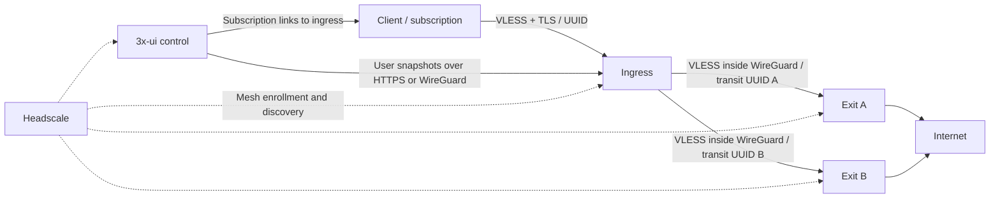

# VLESS mesh: ingress → exit

A C++20/YAML deployment for authenticated, two-hop VLESS routing over a Headscale-managed mesh. It includes Ansible provisioning and real Podman integration tests. The project is in development; the [verification reports](docs/ansible-verification.md) describe the tested scope and operational limits.

Three services, all based on `debian:stable-slim`:

* **in**: public Xray VLESS listener. Authenticated client UUID → user email → explicitly allowed exit. One ingress supports many exits. It has no direct internet outbound.
* **out**: mesh-only VLESS listener, authenticated by a separate transit UUID, forwarding to the internet through Xray Freedom. No public VLESS port.
* **control**: 3x-ui v3.11.0 for users, admin and subscriptions. Ingress agents pull users from one designated inbound. Headscale is an independent network control plane.



The custom application is C++20; YAML is the operator-facing format. Xray owns protocol parsing, encryption and forwarding. Tailscale owns WireGuard, discovery, NAT traversal and DERP fallback. This avoids implementing a new proxy protocol or tunnel.

## Build and run a real local stand

Requires a running Podman Linux machine with `/dev/net/tun`, network access, OpenSSL and Python 3.9+. Existing unrelated containers are untouched.

```sh
./scripts/build.sh
python3 tests/stand.py up
python3 tests/validate.py
python3 tests/stand.py test
python3 tests/tls.py
python3 tests/stability.py
# Keep the stand running for inspection; remove when finished:
python3 tests/stand.py down
```

The stand runs real Headscale, 3x-ui, ingress, two exits, a VLESS client and an HTTP witness. Its cleartext public VLESS and panel HTTP URL are **lab-only**, explicitly enabled in generated YAML. Headscale uses HTTPS with a generated local CA; the additional TLS test temporarily enables and verifies TLS on public VLESS. Published ports bind localhost. The test checks actual exit source addresses, direct P2P, external HTTPS, authentication failure, control outage, user revocation, subscriptions, TLS, and stale/corrupt-cache failure recovery. Generated credentials and configuration are under `.local/`, ignored by Git. Admin: `http://127.0.0.1:12053`; SOCKS clients: `127.0.0.1:11080` and `:11081`; ingress: `127.0.0.1:14443`.

Local verification results: [docs/verification.md](docs/verification.md).

## Deploy the full system with Ansible

[deploy/ansible/README.md](deploy/ansible/README.md) covers installation and the Debian SSH inventory. The playbook provisions Headscale with ACLs, control and an HTTPS subscription gateway, exits, ingress, persistent credentials and user subscriptions. YAML inventory is the source of managed accounts and routes.

After installing its pinned requirements and building the images:

```sh
python3 tests/ansible.py run
```

This creates a separate local Podman deployment. It tests unchanged reruns, adding a user, adding an ingress for existing accounts, and assigning an existing account to a newly added exit. Generated subscriptions and credentials remain private under `.local/ansible-test/controller`.

Completed results: [docs/ansible-verification.md](docs/ansible-verification.md).

## Production configuration

For REALITY with `xtls-rprx-vision`, use [config/in-reality.yaml](config/in-reality.yaml) and the [REALITY configuration guide](docs/reality.md). The existing TLS profile remains supported.

Use [config/in.yaml](config/in.yaml), [config/out.yaml](config/out.yaml) and [config/control.yaml](config/control.yaml). Create the files referenced under `/run/secrets`; mount them read-only from `secrets/{in,out,control}`. Generate distinct UUIDs for transit credentials and users. Share an exit's transit credential only with its authorized ingresses. Provision a separate Headscale auth key for each node; persist node identity volumes and back up 3x-ui's database.

On each corresponding Linux host:

```sh
podman compose -f infra/compose.yaml --profile in up -d
podman compose -f infra/compose.yaml --profile out up -d
podman compose -f infra/compose.yaml --profile control up -d
```

These commands are alternatives for separate hosts. Ingress and exit both use UDP 41641; change host mappings when colocating them. Build common before control. `podman compose` requires an installed Compose provider; the local stand uses Podman directly.

Set real HTTPS Headscale and panel URLs. Install ingress TLS certificates and configure the public hostname in the client subscription. All ingresses sharing one directory inbound must have the matching TLS/REALITY profile (including SNI, keys and flow); use separate directory inbounds for distinct profiles. The exit's `listener.address: mesh` resolves to its own Tailscale IPv4 at startup. Set ingress exit addresses to the allocated mesh IPs. Accepting DNS and advertised subnet routes is deliberately disabled; panel hostnames need normal DNS records (MagicDNS is not accepted). Configure explicit Headscale ACLs: ingress tags → exit tags TCP 8443 and ingress → panel TCP 2053 only; keep exit-to-exit and unsolicited access denied. [docs/architecture.md](docs/architecture.md) includes the deployment boundaries.

In 3x-ui, create one VLESS inbound as the user directory, with the same stream settings and port as the public ingress. Bind its local listener to loopback; it is not a public ingress. Add an **External Proxy** entry per ingress with its public DNS name, VLESS port and matching TLS setting. Enable subscription service and serve it behind HTTPS. The stand seeds and verifies this pattern against 3x-ui's real subscription endpoint.

Give each exit choice a distinct user UUID and unique email (e.g. `alice-eu`, `alice-us`) with separate subscription IDs (3x-ui v3 requires globally unique IDs). Map each email in ingress YAML `routes`. Each subscription fans out to the configured ingress endpoints. Clients choose the corresponding exit subscription/entry; the authenticated UUID selects the exit. Routes cannot name arbitrary destinations supplied by clients. To add a user, add its route in YAML, restart ingress with that policy, then enable the panel user. The route allowlist is intentional: unknown routes reject the snapshot.

Control YAML initializes admin credentials/port/path once per fresh database and preserves imported databases; the `.provisioned` marker prevents overwriting later UI changes. Rotate credentials through 3x-ui and update ingress credential files together. The panel admin and subscription listeners are published only on loopback; use an HTTPS reverse proxy for external access. Allow ingress mesh access to the panel with firewall/ACL rules.

## Stability boundaries

* Candidate configs are validated by `xray run -test` before replacing active configuration. Invalid snapshots and HTTP failures retain last-known-good users.
* Valid users are cached durably in `/var/lib/node`. A restart can recover during a panel outage. `max_stale_seconds` defaults to 86400; after that the ingress removes cached users. Fixed expiry is enforced locally even during panel outages. Revocations cannot propagate while the panel is unavailable. After recovery, session reauthentication/network timeouts can add delay to the normal poll interval (up to 15 seconds per HTTP request).
* Process failures terminate the container for restart by Podman. Tini reaps child processes; shutdown is bounded; node health uses a recent supervisor heartbeat. Health is **process readiness**, not proof of internet reachability. Podman builds use Docker image format to preserve health checks.
* Applying a changed user set restarts Xray and interrupts current connections. Updates are infrequent and unchanged snapshots do not restart it. Deploy multiple ingresses and stagger policy changes for availability; this implementation does not claim zero-downtime user updates.
* Headscale is discovery/control, not the payload relay. Peers on a reachable LAN use direct WireGuard. Direct connectivity cannot be guaranteed across arbitrary firewalls; keep DERP fallback for availability, monitor `tailscale ping`, and permit UDP. A direct-path assertion is part of the local test.
* Global traffic quotas, first-use expiry, device/IP limits and remote traffic statistics are not implemented. Configure unlimited traffic, fixed expiry and no device limits. The agent rejects quota/first-use/device-limit settings and unsupported VLESS encryption. Do not rely on panel local counters for remote ingress enforcement.

Versions and sources: [Xray routing](https://xtls.github.io/en/config/routing.html), [3x-ui API](https://github.com/MHSanaei/3x-ui/blob/v3.11.0/docs/content/docs/en/reference/api/inbounds.mdx), [Headscale configuration](https://github.com/juanfont/headscale/blob/v0.29.7/config-example.yaml), [Tailscale container networking](https://tailscale.com/docs/features/containers/docker/docker-params). Xray 26.11.9 and Tailscale 1.104.5 downloads are checksum-verified; 3x-ui and Headscale are pinned to release tags. `debian:stable-slim` tracks stable security updates; capture image digests in a deployment registry for immutable production rollouts.

## Repository and contributions

`src/` contains the node agent, `infra/` the image build recipes, `config/` the production configuration examples, `deploy/ansible/` the orchestrated deployment, and `tests/` the unit and integration checks.

See [CONTRIBUTING.md](CONTRIBUTING.md) for validation commands, [SECURITY.md](SECURITY.md) for private vulnerability reporting, and [the GitHub publishing guide](docs/publishing.md) for repository setup. GitHub Actions runs source checks and renderer contracts; the full networking suite is manually triggered on a disposable hosted runner. The workflows do not publish images or deployment secrets.

## License

Original project source, configuration and documentation are licensed under [Apache-2.0](LICENSE). Third-party components retain their own licenses; see [THIRD_PARTY_NOTICES.md](THIRD_PARTY_NOTICES.md). The current image recipes are for local builds; complete third-party notice/source packaging before distributing built images.
